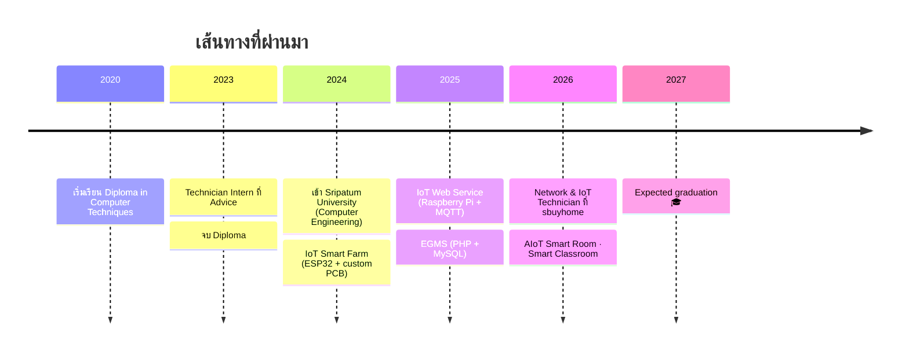
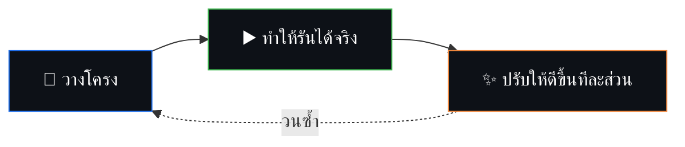

<!-- ═══════════════ HEADER ═══════════════ -->
<div align="center">


<a href="https://poundkung11.github.io/">

</a>

<br/>


[](https://poundkung11.github.io/)


</div>

<!-- ═══════════════ LIVE FLOW ═══════════════ -->
<div align="center">


</div>


## 👋 About Me

นักศึกษาวิศวกรรมคอมพิวเตอร์ชั้นปีที่ 4 (CGPA 3.40) มหาวิทยาลัยศรีปทุม
มีประสบการณ์ด้าน **การตั้งค่าและแก้ปัญหาเครือข่าย** และโปรเจกต์ **IoT** ด้วย ESP32, Raspberry Pi, MQTT, PHP และ MySQL
สนใจระบบที่เชื่อม **Hardware กับ Software** เข้าด้วยกัน ทั้ง Embedded, Full-Stack, Real-time Systems และ Computer Vision

ชอบสร้าง Prototype เวลาว่างคิดอะไรแปลกๆ แล้วลองทำ ถ้าอันไหนไปต่อได้ก็พัฒนาให้ใช้งานได้จริง
และชอบใช้ AI กับ Automation ช่วยออกแบบระบบและเร่งการพัฒนา

```ts
const poundkung11 = {
  name: "Latthaphon Sattha",
  studying: "B.Eng. Computer Engineering @ Sripatum University (2027)",
  lookingFor: ["IoT Engineer", "Network Engineer", "IoT R&D Engineer", "Full-Stack / Embedded Developer"],
  focus: ["Device Integration", "Prototyping", "System Testing", "Troubleshooting"],
  funFact: "I built a system that recognizes faces in classrooms 👁️",
};
```

### 🎯 Right now

| | |
|:--|:--|
| 🔭 **กำลังทำ** | AIoT Smart Room System · Smart Classroom Attendance |
| 🌐 **ฝึกต่อยอด** | Networking (VLAN, VPN, Routing) · Computer Vision · TypeScript |
| 🤝 **มองหา** | โอกาส Co-op ด้าน IoT / Network / R&D / Full-Stack |
| ⚡ **ถามผมได้เรื่อง** | ESP32, MQTT, Raspberry Pi, ตั้งค่า Router/Switch, ออกแบบ PCB เบื้องต้น, OpenCV |


## 🛤️ Journey




## 🛠️ Tech Stack

<div align="center">


<br/>

<br/>

<br/>


</div>

<details open>
<summary><b>🔌 IoT & Embedded</b></summary>
<br/>


</details>

<details>
<summary><b>🌐 Networking</b></summary>
<br/>


</details>

<details>
<summary><b>💻 Programming & Web</b></summary>
<br/>


</details>

<details>
<summary><b>👁️ AI / Data</b></summary>
<br/>


</details>


## 💼 Experience

| Role | Where | When |
|:--|:--|:-:|
| **Network & IoT Technician** | sbuyhome | 2026 |
| **Technician Intern** | Advice | 2023 |

<details>
<summary>ดูรายละเอียดงานที่ sbuyhome</summary>
<br/>

- ตั้งค่า Router, Switch, Wireless AP, VPN remote access และ IP addressing
- ติดตั้งและดูแลระบบ CCTV, Network และ Smart Home
- ทดสอบ Smart Switch ก่อนนำไปใช้งานจริง
- แก้ปัญหา Windows / Network / IoT และช่วยลูกค้าตั้งค่าระบบ
- เขียนเอกสารเทคนิคและคู่มือการติดตั้ง

</details>


## 🚀 Projects

<div align="center">

<a href="https://github.com/poundkung11/SmartVision-Classroom">
  
</a>
<a href="https://github.com/poundkung11/CFRS">
  
</a>
<br/>
<a href="https://github.com/poundkung11/sabaidimai-fixed">
  
</a>

</div>

<details open>
<summary><b>🏠 AIoT Smart Room System</b> · 2026</summary>
<br/>

ระบบ AIoT ใช้ MQTT สำหรับ monitoring แบบ real-time และ energy automation พร้อมเอกสารออกแบบระบบสำหรับ validate prototype

  

</details>

<details open>
<summary><b>🏫 Smart Classroom Attendance System</b> · 2026</summary>
<br/>

เช็คชื่อด้วย Face Recognition และวิเคราะห์พฤติกรรม เชื่อม RTSP streaming, backend APIs และ dashboard ติดตามแบบ real-time
(โค้ดอยู่ที่ [SmartVision-Classroom](https://github.com/poundkung11/SmartVision-Classroom) และ [CFRS](https://github.com/poundkung11/CFRS))

  

</details>

<details>
<summary><b>📡 IoT Web Service (Raspberry Pi & MQTT)</b> · 2025</summary>
<br/>

IoT backend ด้วย Raspberry Pi, MQTT, PHP และ MySQL สำหรับสื่อสารและ monitor ข้อมูลแบบ real-time

  

</details>

<details>
<summary><b>🧰 Equipment & Grouping Management System (EGMS)</b> · 2025</summary>
<br/>

Full-stack web app (PHP, MySQL) พร้อมทำ UAT และ regression testing

</details>

<details>
<summary><b>🌱 IoT Smart Farm</b> · 2024</summary>
<br/>

ระบบรดน้ำอัตโนมัติด้วย custom PCB และ ESP32 เชื่อม soil sensors พร้อม monitoring แบบ real-time

 

</details>

<details>
<summary><b>🎓 โปรเจกต์มหาวิทยาลัย / วิศวกรรมอื่นๆ</b></summary>
<br/>

| Project | รายละเอียด |
|:--|:--|
| 🌐 [**sabaidimai-fixed**](https://github.com/poundkung11/sabaidimai-fixed) | Web app ด้วย TypeScript architecture สมัยใหม่ |
| 🏎️ **Line Tracking Robot** | รถหุ่นยนต์ตามเส้น |
| 🏥 **Hospital App with AI Assistant** | แอปโรงพยาบาลที่มี AI เป็นผู้ช่วย |
| ⚡ **Smart Plug & PCB Design** | ปลั๊กอัจฉริยะพร้อมออกแบบ PCB เอง |
| 🏫 **Web Clone MFU** | ฝึกทำ Front-end โดยจำลองเว็บไซต์ MFU |

</details>


## 🧠 Work Philosophy



เน้น **Integration** · **Practicality** · **Stability** · **Problem Solving**

### 🎯 Goals

กำลังพัฒนาตัวเองไปสู่การเป็น **IoT / Network / Embedded Engineer** หรือ **Full-Stack Developer**
มองหางานที่ได้ใช้ทั้ง "การคิดเชิงระบบ" และ "การลงมือทำจริง" และพร้อมเรียนรู้เครื่องมือใหม่ๆ อยู่เสมอ


## 📊 GitHub Stats

<div align="center">


<br/><br/>


<br/><br/>


<br/>

<!-- Snake: ต้องเปิดใช้ workflow .github/workflows/snake.yml ก่อน -->
<picture>
  <source media="(prefers-color-scheme: dark)" srcset="https://raw.githubusercontent.com/poundkung11/poundkung11/output/github-contribution-grid-snake-dark.svg"/>
  <source media="(prefers-color-scheme: light)" srcset="https://raw.githubusercontent.com/poundkung11/poundkung11/output/github-contribution-grid-snake.svg"/>
  
</picture>

</div>


## 📬 Contact

<div align="center">

[](mailto:latthaphon.sat@gmail.com)
[](https://line.me/ti/p/poundkung11)
[](https://www.linkedin.com/in/latthaphon-sattha-38290a2b1)
[](https://github.com/poundkung11)
[](https://poundkung11.github.io/)

<br/>


</div>
