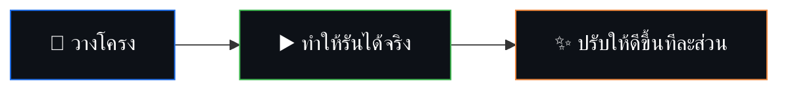

<!-- ═══════════════ HEADER ═══════════════ -->
<div align="center">


<a href="https://poundkung11.github.io/">

</a>

<br/>


</div>

<br/>

## 👋 About Me

นักศึกษาวิศวกรรมคอมพิวเตอร์ชั้นปีที่ 4 (CGPA 3.40) มหาวิทยาลัยศรีปทุม
มีประสบการณ์ด้าน **การตั้งค่าและแก้ปัญหาเครือข่าย** และโปรเจกต์ **IoT** ด้วย ESP32, Raspberry Pi, MQTT, PHP และ MySQL
ชอบสร้าง Prototype เวลาว่างคิดอะไรแปลกๆ แล้วลองทำ ถ้าอันไหนไปต่อได้ก็พัฒนาให้ใช้งานได้จริง

```ts
const poundkung11 = {
  name: "Latthaphon Sattha",
  studying: "B.Eng. Computer Engineering @ Sripatum University (2027)",
  lookingFor: ["IoT Engineer", "Network Engineer", "IoT R&D Engineer"],
  focus: ["Device Integration", "Prototyping", "System Testing", "Troubleshooting"],
  funFact: "I built a system that recognizes faces in classrooms 👁️",
};
```

<br/>

## 💼 Experience

| Role | Where | When |
|:--|:--|:-:|
| **Network & IoT Technician** | sbuyhome | 2026 |
| **Technician Intern** | Advice | 2023 |

- ตั้งค่า Router, Switch, Wireless AP, VPN remote access และ IP addressing
- ติดตั้งและดูแลระบบ CCTV, Network และ Smart Home
- ทดสอบ Smart Switch ก่อนนำไปใช้งานจริง และเขียนเอกสารคู่มือการติดตั้ง

<br/>

## 🛠️ Tech Stack

<div align="center">


<br/>

<br/>

<br/>


</div>

| Area | Skills |
|:--|:--|
| 🔌 **IoT & Embedded** | ESP32 · Raspberry Pi · MQTT (Mosquitto) · PCB Design · Embedded Programming |
| 🌐 **Networking** | OSI / TCP-IP · IPv4 · Subnetting · VLAN · DHCP · DNS · NAT · Routing & Switching · VPN |
| 💻 **Programming** | Python · C · C++ · Java (Basic) · TypeScript · JavaScript |
| 🗄️ **Web & Database** | PHP · MySQL · MongoDB · HTML/CSS · Apache · React · Next.js |
| 👁️ **AI / Data** | Machine Learning · Computer Vision · OpenCV · NumPy · Pandas |

<br/>

## 🚀 Projects

<div align="center">

<a href="https://github.com/poundkung11/SmartVision-Classroom">
  
</a>
<a href="https://github.com/poundkung11/CFRS">
  
</a>

</div>

| Year | Project | Highlights |
|:-:|:--|:--|
| 2026 | **AIoT Smart Room System** | MQTT real-time monitoring และ energy automation, system design + documentation |
| 2026 | **Smart Classroom Attendance** | Face recognition + behavior analysis, RTSP streaming, backend APIs, real-time dashboard |
| 2025 | **IoT Web Service** | Raspberry Pi + MQTT + PHP + MySQL สำหรับส่งข้อมูลและ monitor แบบ real-time |
| 2025 | **EGMS** (Equipment & Grouping Mgmt) | Full-stack PHP/MySQL, ทำ UAT และ regression testing |
| 2024 | **IoT Smart Farm** | ระบบรดน้ำอัตโนมัติ ด้วย custom PCB + ESP32 และ soil sensors |

<br/>

## 🧠 Work Philosophy



เน้น **Integration** · **Practicality** · **Stability** · **Problem Solving**

<br/>

## 📊 GitHub Stats

<div align="center">


</div>

<br/>

## 📬 Contact

<div align="center">

[](mailto:latthaphon.sat@gmail.com)
[](https://line.me/ti/p/poundkung11)
[](https://www.linkedin.com/in/latthaphon-sattha-38290a2b1)
[](https://poundkung11.github.io/)


</div>
