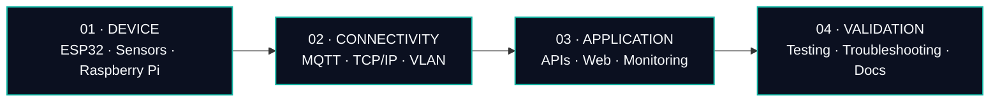

### I connect devices, networks, and software into systems people can use.

นักศึกษาวิศวกรรมคอมพิวเตอร์ชั้นปีที่ 4 มหาวิทยาลัยศรีปทุม · CGPA 3.40 · คาดว่าจะจบปี 2027

---

## FIELD MAP

ชอบทำงานที่เชื่อมหลายชั้นเข้าด้วยกัน ตั้งแต่ต่ออุปกรณ์และวางระบบเครือข่าย ไปจนถึงทำ backend, dashboard และทดสอบหน้างาน สนุกกับการขึ้น Prototype แล้วค่อยปรับให้เสถียรและใช้งานได้จริง

## SELECTED BUILDS

| YEAR | PROJECT | WHAT IT DOES |
|:--:|:--|:--|
| 2026 | **Smart Classroom Attendance** | Face recognition และ behavior analysis ผ่าน RTSP พร้อม backend APIs และ real-time dashboard |
| 2026 | **AIoT Smart Room System** | ตรวจวัดข้อมูลผ่าน MQTT แบบ real-time และทำ energy automation พร้อมออกแบบระบบและจัดทำเอกสาร |
| 2025 | **IoT Web Service** | Raspberry Pi, MQTT, PHP และ MySQL สำหรับรับส่งและ monitor ข้อมูลแบบ real-time |
| 2025 | **EGMS** · Equipment & Grouping Management | พัฒนา Full-stack ด้วย PHP/MySQL พร้อมทำ UAT และ regression testing |
| 2024 | **IoT Smart Farm** | ระบบรดน้ำอัตโนมัติจาก custom PCB, ESP32 และ soil sensors |

## EXPERIENCE

### Network & IoT Technician · sbuyhome
`2026`

- ตั้งค่า Router, Switch, Wireless AP, VPN remote access และ IP addressing
- ติดตั้งและดูแลระบบ CCTV, Network และ Smart Home
- ทดสอบ Smart Switch ก่อนใช้งานจริง พร้อมจัดทำคู่มือติดตั้ง

### Technician Intern · Advice
`2023`

## TOOLKIT

| LAYER | TOOLS & SKILLS |
|:--|:--|
| **Embedded & IoT** | ESP32 · Raspberry Pi · Arduino · MQTT / Mosquitto · PCB design |
| **Networks** | TCP/IP · IPv4 · Subnetting · VLAN · DHCP · DNS · NAT · Routing & Switching · VPN |
| **Languages** | Python · C · C++ · TypeScript · JavaScript · PHP · Java (basic) |
| **Web & Data** | React · Next.js · Node.js · Flask · FastAPI · MySQL · MongoDB · SQLite · Apache |
| **Vision & Analysis** | OpenCV · Machine Learning · NumPy · Pandas |
| **Tools** | Linux · Git · GitHub · VS Code |

## WORK LOOP

`OBSERVE`　→　`PROTOTYPE`　→　`TEST`　→　`REFINE`

**Integration · Practicality · Stability · Problem solving**

## FIND ME

